<picture>
  <source media="(prefers-color-scheme: dark)" srcset="hello-dark.svg">
  
</picture>

<picture>
  <source media="(prefers-color-scheme: dark)" srcset="h2-know-dark.svg">
  
</picture>

<table>
  <tr>
    <td width="50%" valign="top"><b>Alert triage and investigation</b>, from the first alert to root cause</td>
    <td width="50%" valign="top"><b>Windows and Linux logging:</b> Security event IDs, Sysmon, auth.log, syslog</td>
  </tr>
  <tr>
    <td valign="top"><b>Detection engineering:</b> SPL and KQL searches, and Sigma rules that work across SIEMs</td>
    <td valign="top"><b>Mapping findings to MITRE ATT&CK</b></td>
  </tr>
  <tr>
    <td valign="top"><b>Phishing analysis:</b> headers, SPF/DKIM/DMARC, attachments and links</td>
    <td valign="top"><b>Incident response:</b> the NIST lifecycle, playbooks, and writing up findings</td>
  </tr>
  <tr>
    <td colspan="2" valign="top"><b>Network analysis:</b> packet captures, Zeek logs, pulling out IOCs</td>
  </tr>
</table>

<picture>
  <source media="(prefers-color-scheme: dark)" srcset="h2-done-dark.svg">
  
</picture>

Every investigation I work on goes into my journal, written up the way a SOC report would be:
what fired, what I checked, what I found, and what I'd do next.

<picture>
  <source media="(prefers-color-scheme: dark)" srcset="attack-dark.svg">
  
</picture>

<picture>
  <source media="(prefers-color-scheme: dark)" srcset="h2-experience-dark.svg">
  
</picture>

**● Cybersecurity and Technical Support Specialist**
> **KayCore**
>
> Built a security compliance assessment program covering SSL/TLS, email authentication, MFA,
> access control and incident response, mapped to NIST, OWASP and PCI-DSS.
>
> `NIST` `OWASP` `PCI-DSS`

**● Build Student Consultant**
> **The Build Fellowship (Open Avenues Foundation)**
>
> Built and deployed SafeAPI, a secure login app on Google Cloud with layered defenses:
> Firebase Authentication, App Check, rate limiting, and Cloud Armor.
>
> `Firebase Authentication` `App Check` `Rate limiting` `Cloud Armor`

<picture>
  <source media="(prefers-color-scheme: dark)" srcset="h2-tools-dark.svg">
  
</picture>

| Area | Tools |
|---|---|
| SIEM |     |
| Endpoint |    |
| Network |    |
| Threat intel |    |
| Forensics |  |
| Cloud |   |
| Systems |  -E95420?style=flat-square&logo=ubuntu&logoColor=white)  |
| Query and scripting |       |

<picture>
  <source media="(prefers-color-scheme: dark)" srcset="h2-contact-dark.svg">
  
</picture>

